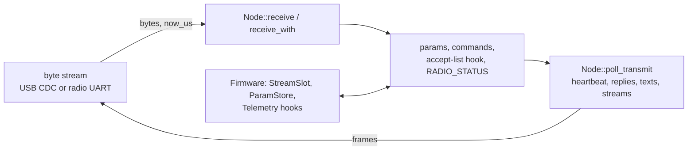

# mavlink-device

MAVLink 2 device layer for the MARV V2 flight controller. `no_std`, on any byte stream: it knows nothing about USB, a transport or
an executor. `Node` is a sans-IO core, bytes and a time in, frames out, with heartbeat, a stream scheduler, status text, the
parameter protocol, commands, an accept list for messages that other nodes forward, and RADIO_STATUS flow control. `Node::run`
drives it over `embedded_io_async::{Read, Write}` and an `embedded_hal_async` `DelayNs`; no executor crate. Messages come from
[marv-dialect](https://github.com/Lmx154/marv-dialect) (a git dependency pinned to a commit), re-exported as
`mavlink_device::dialect` and `mavlink_device::marv`. Other dependencies: `embedded-io-async` 0.7, `embedded-hal-async` 1.0 and
optionally `defmt`.



The contract with the ground station is [`docs/link-contract.md` of MARV-GCS](https://github.com/Lmx154/MARV-GCS/blob/main/docs/link-contract.md).

## Quick start

```rust
let mut slots = [StreamSlot::new(Stream { message_id: 29, default_interval_us: 100_000, min_interval_us: 20_000 })];
let mut node = Node::new(Config::new(1, 1), &mut slots);
// On each wake: bytes from the link, then frames until None, then sleep until next_deadline_us().
node.receive(&bytes, now_us(), &mut params);
let mut frame = [0u8; 280];
while let Some(n) = node.poll_transmit(now_us(), &params, &mut telemetry, &mut frame) {
    link.write_all(&frame[..n]).await?;
}
let wake_at = node.next_deadline_us(); // not after now: poll again at once
```

With a reader and writer the whole loop is one call, in the link task:

```rust
let end = node.run(&mut rx, &mut tx, &mut delay, || now_us(), &mut params, &mut telemetry).await;
// RunError::Read(_) | Write(_) | EndOfStream: the link is gone; node.on_link_down(), wait for it, run again.
```

## Docs

| Page | In one line |
|---|---|
| [node](docs/node.md) | What the node does, the `Telemetry` hooks, rules for correct use, transmit priority, `Stats`, the USB start gate |
| [params-commands](docs/params-commands.md) | Addressing, the parameter protocol, COMMAND_LONG and the command hooks |
| [link-flow](docs/link-flow.md) | The accept list and hand-over, RADIO_STATUS slowdown |
| [testing](docs/testing.md) | Host tests, target build, features, what is not covered |
| [hil/](hil/) | On-board demonstration programs (`mavlink_demo`, `mavlink_diag`) |

```text
src/  lib.rs  node.rs (Node, Stats)  node/service.rs  command.rs  run.rs  deframer.rs  accept.rs  config.rs  out.rs  params.rs
hil/  demonstration programs, own workspace      tools/run.sh  build, flash and run a hil program
```

Features, off by default: `defmt`, `_test-hooks` (test-only, not API).

## Used by

[MARV-FC](https://github.com/Lmx154/MARV-FC) (USB and radio MAVLink), [MARV-sim](https://github.com/Lmx154/MARV-sim), and
[rc-port](https://github.com/Lmx154/rc-port), which builds a node for the receiver's MAVLink mode. `marv-dialect` comes through it.

## Status

- Version 0.1.0, `publish = false`; the API may still change.
- Host tests: unit and property tests, every emitted frame decoded by the `mavlink` 0.21.0 crate, a ground-station model over a lossy link.
- Runs on the MARV V2 Rev 1 board over USB (demonstration program against the ground station) and behind an ExpressLRS receiver through `rc-port`.
- Not exercised on the board: the test hook that switches the slowdown off, RC_CHANNELS_OVERRIDE through the hook, long runs.

## MARV project

| Repository | Role |
|---|---|
| [MARV-FC](https://github.com/Lmx154/MARV-FC) | Flight-controller firmware for the MARV V2 board (RP2350B) |
| [MARV-GCS](https://github.com/Lmx154/MARV-GCS) | Ground station (`marv-gcs`) and command line (`marv-cli`) |
| [MARV-sim](https://github.com/Lmx154/MARV-sim) | Simulator that runs the firmware's flight code |
| Sensors | [icm45686](https://github.com/Lmx154/icm45686-rs) · [lsm6dsk320x](https://github.com/Lmx154/lsm6dsk320x-rs) · [bmp581](https://github.com/Lmx154/bmp581-rs) · [bmm350](https://github.com/Lmx154/bmm350-rs) · [sam-m10q](https://github.com/Lmx154/sam-m10q) · [adc-battery](https://github.com/Lmx154/adc-battery) |
| Board I/O | [pio-sdmmc](https://github.com/Lmx154/pio-sdmmc-rs) · [qmi-psram](https://github.com/Lmx154/qmi-psram-rs) · [ws2812c](https://github.com/Lmx154/ws2812c-rs) · [usb-cdc](https://github.com/Lmx154/usb-cdc) · [pio-uart](https://github.com/Lmx154/pio-uart) |
| Motors and links | [dshot](https://github.com/Lmx154/dshot-rs) · [esc-passthrough](https://github.com/Lmx154/esc-passthrough) · [rc-port](https://github.com/Lmx154/rc-port) · [crsf-codec](https://github.com/Lmx154/crsf-codec) · **mavlink-device** · [marv-dialect](https://github.com/Lmx154/marv-dialect) |
| Other drivers | [lc76g](https://github.com/Lmx154/lc76g-rs) (Quectel LC76G GNSS) |

## Licence

MIT, see `LICENSE`.
