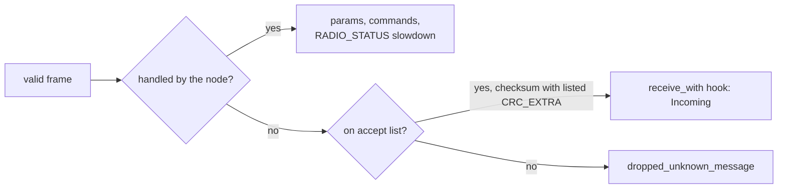

# Accept list and RADIO_STATUS

Part of [mavlink-device](../README.md)

Two features for a link where other nodes talk through the same port, such as an ExpressLRS receiver in MAVLink mode, which
forwards RC_CHANNELS_OVERRIDE and ground-station traffic, including messages of the project's own dialect. The accept list hands
chosen messages to the application; RADIO_STATUS slows the node's streams when the radio's transmit buffer fills.



## The accept list and the hand-over

```rust
let config = Config::new(1, 1)
    .with_accept_list(&[
        (RC_CHANNELS_OVERRIDE_DATA::ID, RC_CHANNELS_OVERRIDE_DATA::EXTRA_CRC),
        (RADIO_STATUS_DATA::ID, RADIO_STATUS_DATA::EXTRA_CRC),
    ])?; // Err(AcceptListFull) beyond 16 entries; nothing is truncated
let mut node = Node::new(config, &mut slots);
node.receive_with(&bytes, now_us(), &mut params, &mut |m: Incoming<'_>| {
    if let Some(rc) = m.decode::<RC_CHANNELS_OVERRIDE_DATA>() { /* m.system_id, m.component_id, m.now_us */ }
});
```

- The list is a fixed array of at most 16 (message id, CRC_EXTRA) pairs inside `Config`: no allocation, no lifetime on `Node`.
  `with_accept_list` is `const` and returns `Err(AcceptListFull)` for more. Take the pair from the `marv-dialect` type (`ID`,
  `EXTRA_CRC`). `AcceptList::iter()` yields pairs in insertion order, `contains(id)` tests an id, and `AcceptList::from_pairs`
  rebuilds a list read back through `Config::accept`.
- `Node::receive_with(bytes, now_us, params, on_message)` calls the hook synchronously, once per frame. `Node::receive` is
  `receive_with` with a hook that does nothing (listed frames are then dropped, uncounted). `Node::run` calls `receive`, so it has no
  hook and drops listed frames.
- A listed frame is handed over only if MAVLink 2 with incompatibility flags 0, checksum right with the listed CRC_EXTRA, and not
  carrying the node's own system id. Otherwise it is counted: `dropped_mavlink1`, `dropped_incompat`, `dropped_listed_checksum`
  (a false start that grows into a candidate is counted too), `dropped_own_system`.
- `Incoming { system_id, component_id, message_id, payload, now_us }`: the payload slice is **exactly as on the wire**. MAVLink 2
  senders cut trailing zero bytes, so it can be shorter than the encoded length, even empty: never index it.
  `Incoming::decode::<M>()` restores the zeros and decodes with the `marv-dialect` type (`None` when `M::ID` differs or it does not
  decode). The slice borrows the receive buffer: copy what is needed inside the hook, which must not block.
- The node does not interpret listed messages, filter them by target, queue or route them. An entry for an id the node handles
  itself (HEARTBEAT, the parameter messages, COMMAND_LONG) has no effect; an entry for RADIO_STATUS (109) hands the frame over after
  the node used it. Other unlisted ids are dropped unchecked and counted in `dropped_unknown_message`.

## RADIO_STATUS slowdown

RADIO_STATUS (109) is handled by the node, from any sender except its own system id, with its checksum checked. Its `txbuf` (percent
of free transmit buffer; a payload with trailing zeros cut reads 0) moves a per-node slowdown exactly as ArduPilot's
`GCS_MAVLINK::handle_radio_status`. The four branches are tried in order; the first that matches runs:

| `txbuf` | While slowdown (ms) | Change |
|---|---|---|
| < 20 | < 2000 | +60 |
| < 50 | < 2000 | +20 |
| > 95 | > 200 | -40 |
| > 90 | not 0 | -20, not below 0 |

Otherwise it does not change. It starts at 0, is reset by `on_link_down`, is read with `Node::stream_slowdown_ms()` and is added to
the interval of every stream each time the stream is rescheduled (HEARTBEAT is not slowed). The bound is not a clamp: from 1980 ms a
`txbuf` < 20 gives 2040 ms, as in ArduPilot; at 2000 ms or more nothing is added. On a link that never carries RADIO_STATUS (USB)
the slowdown stays 0 and the schedule is unchanged (a host test checks it). Order, thresholds and steps were compared with
ArduPilot's source. Not taken from ArduPilot: its multiplication of the interval by 4 during a parameter transfer, a mission
transfer or FTP replies, and its 60 s cap.

The feature `_test-hooks` adds `Node::set_slowdown_off(bool)`: the slowdown is still tracked and reported but no longer added, for a
negative control on the board.

## Code

`src/accept.rs` (`AcceptList`, `Incoming`), `src/node.rs` (`receive_with`, the slowdown).

## Related

[node](node.md); [rc-port](https://github.com/Lmx154/rc-port) builds the accept list and reports `stream_slowdown_ms`.
