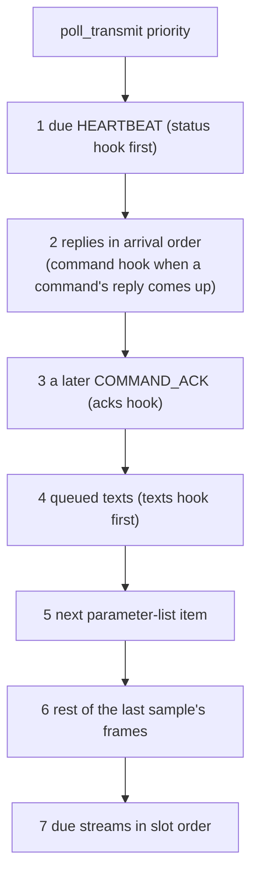
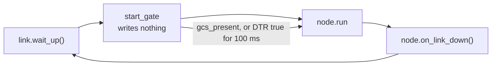

# The node

Part of [mavlink-device](../README.md)

`Node` owns framing, the sequence counter, the queues and the protocol. The firmware owns the `[StreamSlot]` slice, the `ParamStore`
(storage, validation, persistence), the `Telemetry` hook, the clock, the task and the byte stream. Framing is at the message-struct
level (`serialize_message_data`, `deser`, `calculate_crc`); there is no dialect enum.



## What is here

| Feature | Detail |
|---|---|
| HEARTBEAT | 1 Hz from `Config` and `set_status` (or `Telemetry::status`); `custom_mode` from `Telemetry::custom_mode` (default 0); `gcs_present` and `gcs_seen_us` (time of the ground station's latest HEARTBEAT) |
| Streams | `StreamSlot`s plus a `Telemetry::sample` hook asked for each message when due |
| Texts | A queue of 4 STATUSTEXT (`queue_text`, or `Telemetry::texts`) |
| Parameters, commands | See [params-commands](params-commands.md) |
| Accept list, RADIO_STATUS | See [link-flow](link-flow.md) |
| `Node::run` | The async driver; wakes at least every 100 ms |

`Telemetry::sample(message_id, now_us, out)` is called once per period of a stream; push up to 4 frames with `out.push(&message)`
(for example four HIGHRES_IMU instances) and return `true`. Nothing is queued across periods: a late caller skips missed periods,
never bursts. A default interval of zero or less is off; one below `min_interval_us` is raised to it.

## The `Telemetry` trait

One required method and four provided ones (existing implementers compile unchanged):

```rust
pub trait Telemetry {
    fn sample(&mut self, message_id: u32, now_us: u64, out: &mut Outgoing<'_>) -> bool;
    fn status(&mut self, now_us: u64) -> Option<dialect::MavState> { None }
    fn texts(&mut self, now_us: u64, out: &mut Texts<'_>) {}
    fn command(&mut self, req: &CommandRequest, now_us: u64) -> CommandOutcome { CommandOutcome::UNSUPPORTED }
    fn acks(&mut self, now_us: u64) -> Option<LateAck> { None }
}
impl Texts<'_> {
    pub fn push(&mut self, severity: dialect::MavSeverity, text: &str) -> Result<(), Full>;
}
```

While `run` is awaited the node is borrowed, so `set_status` and `queue_text` cannot be called; status and texts go through hooks
called from the link task. Hooks must not block.

| Hook | Behaviour |
|---|---|
| `status` | Called once right before each HEARTBEAT is built. `Some(state)` becomes the status from then on, as `set_status` would; `None` leaves it |
| `texts` | Called at most once per `poll_transmit`, only when no HEARTBEAT is due and no reply waits, and only while the queue has room. `Texts::push` has the rules of `queue_text`: cut at 50 bytes on a character boundary, `id` and `chunk_seq` 0; one that does not fit returns `Full` and counts in `Stats::texts_dropped`. An offered text goes out at the next `poll_transmit`, behind a due heartbeat and replies, ahead of list items and streams |
| Idle latency | `next_deadline_us` knows nothing of texts not yet offered, so `run` caps its sleep at 100 ms: an offered text is on the wire within about 100 ms. A sans-IO user must wake by itself at the period it wants |

`set_status` and `Telemetry::status` write the same status (the latest wins); `queue_text` and `Texts::push` fill the same queue.

## Rules for correct use

| Topic | Rule |
|---|---|
| `ParamStore::set` | Called from `receive` (and so from `run`), in the link task |
| Time | Only through `now_us` (microseconds, non-decreasing, on the same clock as the `DelayNs` handed to `run`). No clock, `static`, critical section or allocation in the crate |
| Tasks | Only the link task awaits `run`. Sensor and control tasks hand values over through non-blocking latest-value cells that `Telemetry::sample` reads; values are sampled when due, never queued. A write waits while the host does not read, and while it does the node does not read either |
| Reader | Must be cancel-safe: `run` polls `rx.read` and the timer by hand, and drops the read when the timer wins. The `usb-cdc` reader is cancel-safe |
| Writer | Awaited to completion (`write_all`), each frame handed over whole, so frames never interleave; a write error may leave a frame partly written and `run` returns. A `Write` returning `Ok(0)` for a non-empty buffer panics inside `write_all` (the `embedded-io` rule); the `usb-cdc` writer does not |
| `run` returns only | On a read error (`RunError::Read`), a write error (`RunError::Write`) or a read of 0 bytes (`EndOfStream`). It does not call `on_link_down`; the firmware does, before calling `run` again |
| Receiving | A frame is accepted only if MAVLink 2 with incompatibility flags 0, checksum right for a message the node handles (or for an accept-list message with its CRC_EXTRA), and not carrying the node's own system id. MAVLink 1, flagged (signed too), wrong-checksum, other-message, own-system, other-target and undecodable frames are counted separately. Frames of a message neither handled nor listed, or with an incompatibility flag, are recognised from the header and cannot be checksum-checked, so their bytes count as garbage. Receive buffer 280 bytes. A stray 0xFD never swallows a real frame (a failed candidate is dropped one byte at a time and the rest rescanned); a candidate is waited for until its declared length has arrived |
| Priority | See the diagram. A heartbeat waits at most for the frame being sent, also during a list of 300 parameters with every stream at its fastest. On a link too slow for all streams, late slots are sampled less often. `next_deadline_us` is 0 while a reply, text or pushed frame waits, else the earliest of heartbeat, list item and stream |
| Sequence number | One counter for every frame; for hook-pushed frames it is set when each is sent, so numbers are consecutive on the wire |
| `on_link_down` | Returns every stream to its default interval with a fresh schedule, drops texts, replies, the list in progress and pushed frames, clears the receive buffer and the ground-station presence, sets the slowdown to 0. Sequence counter, heartbeat schedule, status and `Stats` carry on |
| No failsafe | Nothing happens when the ground station is lost, and the node never arms or changes a mode: arming (400) and reboot (246) go to the `command` hook like any other command |

## `Stats`

All counters saturate and survive `on_link_down`. `garbage_bytes`, `heartbeats_received`. Drops: `dropped_not_for_us`, `dropped_unknown_param` (unknown or invalid name,
index out of range), `dropped_reply_full` (4 replies already waiting), `dropped_malformed` (including a COMMAND_LONG with a command
number of neither `common` nor the project's dialect, and a PARAM_SET with an unknown type number), `dropped_listed_checksum`,
`dropped_checksum`, `dropped_mavlink1`, `dropped_incompat`, `dropped_own_system`, `dropped_unknown_message`, `texts_dropped`; and
`frames_sent` (replies and list items included).

## The USB start gate



On a USB link the firmware's link task holds its first write after each link-up until the computer has opened the port. In
`hil/src/bin/mavlink_demo.rs` the loop is `link.wait_up()`, `start_gate`, `node.run`, `node.on_link_down()`. The gate writes nothing;
it waits for the first of bytes from `rx` and a 5 ms timer, gives the bytes to `Node::receive`, and opens when `Node::gcs_present`
is true or when `Link::dtr()` has read true at every check for 100 ms. A read error ends it (link down). After it the node runs as
before, also into a closed port. Why: [link-contract](https://github.com/Lmx154/MARV-GCS/blob/main/docs/link-contract.md) (section
3, "The start gate") and the README of [usb-cdc](https://github.com/Lmx154/usb-cdc).

## Code

`src/node.rs`, `src/out.rs`, `src/run.rs`, `src/deframer.rs`, `src/config.rs`.

## Related

[params-commands](params-commands.md), [link-flow](link-flow.md), [testing](testing.md).
