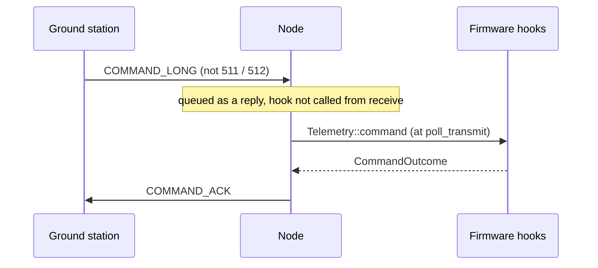

# Parameters and commands

Part of [mavlink-device](../README.md)

The node answers the parameter protocol over the firmware's `ParamStore` and serves some commands itself; every other
COMMAND_LONG goes to the firmware's `Telemetry::command` hook. Replies share one queue, written only when the link may write.

## Addressing and replies

- PARAM_REQUEST_LIST, PARAM_REQUEST_READ, PARAM_SET and COMMAND_LONG are acted on only when `target_system` is the node's or 0 and
  `target_component` is the node's or 0; otherwise `Stats::dropped_not_for_us`.
- At most 4 replies wait (read and set echoes, ACKs, requested messages). A request arriving with the queue full is dropped without
  being acted on (a PARAM_SET does not call `set`) and counted in `dropped_reply_full`; the ground station retries. A command with a
  follow-up (REQUEST_MESSAGE: the ACK, then the message) takes one place for both.

## Parameters

| Request | Behaviour |
|---|---|
| PARAM_REQUEST_LIST | One PARAM_VALUE per `Config::param_list_interval_us` (default 2000 us, per node, not changed by the slowdown); a new request restarts at index 0; a store with no parameters answers one PARAM_VALUE with `param_count` 0 and `param_index` 65535 |
| PARAM_REQUEST_READ | By index, or by name when the index is -1 |
| PARAM_SET | Always one PARAM_VALUE with the value now in effect, also when refused |
| Unknown or invalid names, indices out of range | No reply |

Values are encoded byte-wise: an `I32` travels as its own little-endian bytes in the 4-byte float field (`f32::from_bits(v as u32)`,
back with `to_bits`) with type INT32; an `F32` as itself with REAL32. An `I32` whose bit pattern is a signalling NaN comes back
bit-exact on the host, but this relies on the platform not altering NaN payloads when an `f32` is moved or stored (true for x86-64 SSE
and ARMv8-M, as far as moves go); only checked on x86-64.

A write is refused, without calling `ParamStore::set`, when `param_type` is neither INT32 nor REAL32 or differs from the stored
value's type; otherwise `set` decides: `Ok(v)` is the value in effect, `Err(_)` means refused and `get(index)` is. A PARAM_SET with an
unknown `param_type` number, and a COMMAND_LONG with a number in neither `common` nor the project's dialect, cannot be decoded: no
reply, `Stats::dropped_malformed`.

## Commands the node serves

| Command | Behaviour |
|---|---|
| REQUEST_MESSAGE (512) | ACCEPTED, then one copy of AUTOPILOT_VERSION (148, capabilities MAVLINK2 \| PARAM_ENCODE_BYTEWISE, numbers from `Config::version`), HEARTBEAT (an extra one; the 1 Hz schedule is untouched) or an id in the stream table (one extra `Telemetry::sample` outside the schedule, all frames it pushes; it waits while frames of an earlier sample are pending). Any other id is DENIED. `param2` to `param7` are ignored |
| SET_MESSAGE_INTERVAL (511) | `param1` message id, `param2` interval in us (-1 off, 0 default, otherwise from the stream's `min_interval_us` to 10 s, whole microseconds). DENIED for an id not in the table, HEARTBEAT, `param3` not 0, or an interval out of range. On ACCEPTED the stream restarts from now: its next sample is due at once |

## Commands for the firmware

COMMAND_LONG and COMMAND_ACK use the `marv_dialect::marv` types (re-exported as `mavlink_device::marv`: `common` plus the project's
own messages and commands), so a command that exists only in the project's dialect, for example `MAV_CMD_MARV_DEVICE` (42430), is
valid. COMMAND_INT is not handled.

| Topic | Behaviour |
|---|---|
| What reaches the hook | `Telemetry::command(&mut self, req: &CommandRequest, now_us) -> CommandOutcome` for every COMMAND_LONG addressed to the node that it does not serve itself (511 and 512 never reach it). `CommandRequest { command: marv::MavCmd, params: [f32; 7], sender: Peer, confirmation: u8 }`. Every received frame calls the hook once, a retransmission too (confirmation 0, 1, ...); the node keeps no memory of earlier commands. A command arriving while 4 replies wait is dropped and does not call the hook. The default hook answers UNSUPPORTED |
| Never from `receive` | A command waits in the reply queue and the hook is called when that reply comes up in `poll_transmit`, so only when the link may write, after a due HEARTBEAT and in arrival order with the other replies. A command still waiting at `on_link_down` is dropped without calling the hook |
| The outcome | `CommandOutcome { result: marv::MavResult, progress: u8, result_param2: i32 }` (`new(result)`, `in_progress(percent)`, `UNSUPPORTED`) is sent at once as COMMAND_ACK to the sender, with the command number, `progress` and `result_param2` |
| Long commands | The firmware answers IN_PROGRESS from `command`, then offers later ACKs through `Telemetry::acks(now_us) -> Option<LateAck>` with `LateAck { command, target: Peer, outcome }`: IN_PROGRESS with a percentage as often as it wants, then the final result, each to the original sender. The node asks once per `poll_transmit`, keeps no queue, so the firmware hands each ack out once. Place in the order: after a due HEARTBEAT and waiting replies, ahead of texts, list items and streams, so a firmware that returned `Some` at every call would hold back texts, the list and streams; pace progress ACKs (2 Hz, for example). `acks` is not known to `next_deadline_us`: `run` wakes at least every 100 ms, so an ack is on the wire within about 100 ms |
| Deferred ACK | `Telemetry::command_deferrable(req, now_us) -> Option<CommandOutcome>` replaces `command` under the same rules. `Some(outcome)` is sent at once; `None` sends no COMMAND_ACK now and frees the slot, and the firmware owes exactly one, offered through `acks`. The default is `Some(self.command(req, now_us))` |
| Test control | Feature `_test-hooks` adds `Node::receive_calling_command_hook` (the hook called at once from receive, which the rule forbids); the test of the rule must fail on it, and a test asserts that it does |

## Code

`src/node/service.rs` (parameter requests, commands, the reply queue, the list), `src/command.rs` (`CommandRequest`,
`CommandOutcome`, `LateAck`), `src/params.rs` (`ParamStore`, `ParamName`, `ParamValue`, `ParamError`).

## Related

[node](node.md), [link-flow](link-flow.md); how [rc-port](https://github.com/Lmx154/rc-port) defers commands until it is locked.
